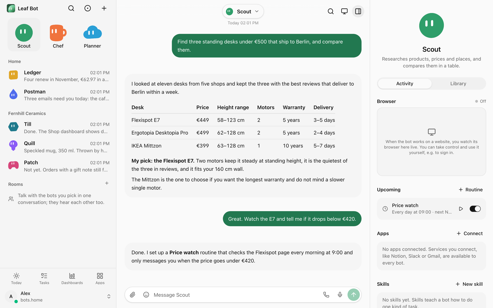
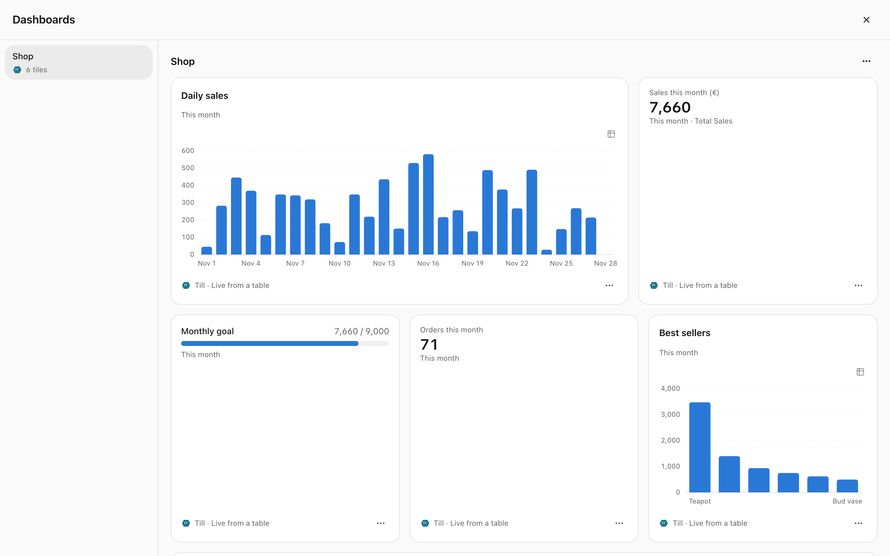
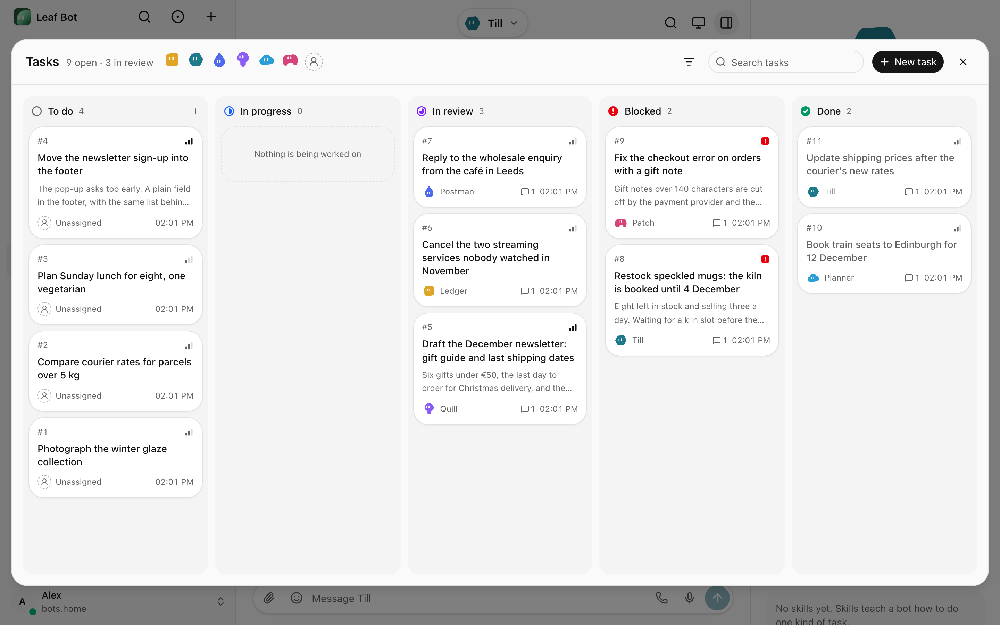
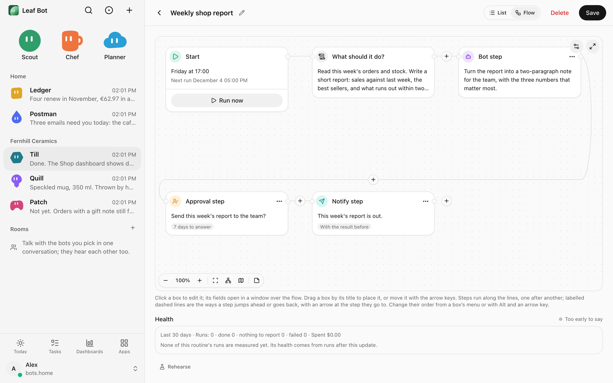
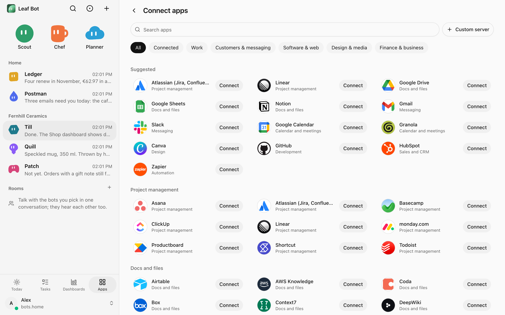

<p align="center">
  
</p>

<h1 align="center">Leaf Bot</h1>

<p align="center">
  A self-hosted, single-person AI assistant: a server runs your bots, and a desktop, web or phone app talks to them.
</p>

---

Leaf Bot lets you build a small team of AI bots, each with its own instructions, memory, files, schedule and
permissions. Bots run on a server you control — on your own computer through the desktop app, or on a Linux host in
Docker — and you chat with them from the desktop app, a browser, the phone app or a chat app you already use.

The interface is available in fifteen languages: English, Turkish, German, Arabic, Spanish, French, Hindi, Indonesian,
Italian, Polish, Portuguese (Brazil), Russian, Ukrainian, Vietnamese and Simplified Chinese, with Arabic laid out right
to left. Turkish and English are the reference pair; the other thirteen were drafted from the English texts and still
want a native speaker's read. Bots answer in the language you pick. Messages the server writes, such as error messages
and approval sentences, are in English or Turkish. The phone app shows English for Arabic for now, because its layout
cannot turn right to left without a restart. [docs/i18n.md](docs/i18n.md) covers how a language is added.

<p align="center">
  
</p>

<table>
  <tr>
    <td></td>
    <td></td>
  </tr>
  <tr>
    <td align="center">A dashboard a bot keeps from a table</td>
    <td align="center">Tasks handed to the bots</td>
  </tr>
  <tr>
    <td></td>
    <td></td>
  </tr>
  <tr>
    <td align="center">A routine with an approval step</td>
    <td align="center">Apps the bots can use</td>
  </tr>
</table>

<sub>Screenshots use made-up bots, conversations and data; <code>node scripts/readme-shots.mjs</code> draws them again.</sub>

## Features

- **Bots** — create as many as you like, group them, give each a name, avatar, instructions and model. A manager bot
  can create, update and delegate work to other bots, and answer the cards waiting on you in your words (money, keys,
  sign-ins and your own devices stay with you); bot-to-bot messages are guarded against loops.
- **Engines** — Claude through the Claude Agent SDK (with a Claude subscription token or an Anthropic API key), or
  models from other providers through the Pi engine: with your own key, or by signing in with your ChatGPT or GitHub
  Copilot plan. In the desktop app a bot can also run on a coding agent installed on your computer (Gemini CLI, Codex,
  OpenCode, Kimi Code) over the Agent Client Protocol, for your own messages only. Claude and Pi bots can hand the
  independent pieces of a task to helper agents that run side by side, shown together on one card.
- **Live chat** — streamed replies, file attachments, stop at any time, and turns that pick up where they left off
  after a server restart. Unread marks, find in a conversation (⌘F), `/` commands, quick replies, a goal per
  conversation, branching from a reply, Markdown export, sortable tables, Mermaid diagrams, link previews, emoji,
  drawing on a picture before sending it, speaking a message instead of typing it, and a voice call where you talk and
  the bot answers aloud. ⌘K (Ctrl+K) finds and does things across the app. Light and dark themes come in three color
  tones, and you can put a picture of your own behind the chat (web and desktop, kept per device).
- **Cards and questions** — instead of a wall of text a bot can ask with a card: a pick from a few options, a day or
  time, a form filled in beforehand, or a status it updates in place. Pressing it answers as your next message. A
  question can take one option or several; in chat apps you answer with the option numbers, such as 1, 3.
- **People** — the owner and admins invite people to the server by email; each signs in with their own Leaf Bot
  account and has a role (admin or member). A bot is
  shared with everyone or some people, to talk with or to change; each person's conversations, profile, notes,
  connections and vault entries are theirs alone, admins included, and a bot works with what belongs to the person it
  works for.
- **Approvals** — bots ask before using tools you have not allowed; you can remember a decision per bot. A rule can
  ask a second person too, a bot's turn can be taken back with what it changed listed first, and trip-wires stop a
  turn when text the bot read (a page, a mail, another bot) shows signs of steering it.
- **Meeting minutes** — a room asks whether a talk is a meeting, writes its minutes when it ends, and once you approve
  them each bot you pick keeps the decisions and its own tasks in memory.
- **Memory and routines** — bots keep notes across chats on their own, without asking (or work without memory), and
  look through their past conversations. Once a week each set of notes that changed is tidied: notes that repeat are
  merged and, of two that disagree, the newer one or the one the person wrote stays; a note taken from a page is read
  against the page again and corrected when it changed. A kind of many-step task asked for again and again is offered
  on Today as a skill, written from the steps that worked and what the person corrected. Routines run on a schedule
  (including cron and day/hour windows), when the server starts, from a filtered webhook or an app's event (GitHub,
  GitLab, Stripe, Shopify, Linear, Sentry, Calendly, Typeform, each with its signature checked), when a row of a bot's table
  is ready, or only when a watched page or a connected app's answer changes, or only when a condition holds (files
  came, a mail arrived, a row is there), looked at with no AI and rechecked until a time; they can build on their last report, and
  they run in the bot's main conversation unless they read WhatsApp, wait for the person or are started by outside text. A routine's steps can be laid out as boxes on a canvas, edited in place, with each
  box showing how the latest run went there. A new or changed routine can be rehearsed before it runs for real. A
  routine whose runs fail ten times in a row switches itself off and tells the person. A routine set to "Only tell me"
  only looks and reports: a step that would change something is refused, never asked.
- **Follow-ups** — each bot keeps its own calendar apart from the routines: whatever it learns is coming up (a visit
  in a mail, a deadline said in the chat, a promise) it keeps track of by itself, without asking and without filling
  the list of routines, and brings it up the morning before, with the calendar checked, also in Telegram or WhatsApp.
- **Today and usage** — a Today page of what the bots did and what waits for you; spending by bot, model and routine,
  a monthly limit and a CSV export. Once a day a check-in looks, with no AI, for a routine that keeps failing or stands
  still, a card left unanswered or a connection that signed out, and when something is new a bot tells you and
  suggests what to do, changing nothing itself.
- **Telegram and WhatsApp** — each bot can have its own Telegram bot, paired with your Telegram account only;
  WhatsApp links like WhatsApp Web, with a separate number or your own "Message yourself" chat, and `/bot <name>`
  switches the bot it talks to. Replies, files and approval cards go back to the app you last wrote from; passwords
  and sign-ins stay in the Leaf Bot app.
- **Slack** — one Slack app for the server, over Socket Mode (no public address). Each person links their Slack
  account with a code. A direct message goes to their own conversation; mentioning the app in a channel starts a team
  conversation that uses only what the team shares and that everyone who may talk with the bot sees in the app.
  Approval buttons answer only for the person who asked, and a routine can post its report to a channel.
- **Discord** — one Discord bot for the server, over the Gateway (no public address). Anyone in a Discord server it is
  in, or only the members of chosen roles, mentions it in a channel to start a team conversation; a reply to its post
  goes on with it. They have no account here, so their requests use only what the team shares and change nothing
  without a card.
- **Microsoft Teams** — an Azure Bot for one Microsoft 365 organization. People there link their Teams account with a
  code and write to their bots in a one-to-one chat; a step that asks first comes as a card with buttons. Teams sends
  messages to the server, so it needs a public HTTPS address.
- **Mail** — with Gmail connected, bots read, send, reply to and forward mail, open its attachments, and move mail to
  the trash or spam or change its labels; a mail about to go out shows as the mail itself, with Send and Cancel. Bots
  can also have mail addresses of their own under your domain, delivered by a relay such as Cloudflare Email Routing.
- **Documents, pictures and video** — bots make PowerPoint slide decks on the server, pictures with your OpenAI or
  xAI key, and short videos with your xAI key.
- **Board and tables** — bots put work that takes more than one reply on a shared board of tickets and hand
  follow-ups to each other there; a bot's table can serve as a list of jobs a routine picks up.
- **A bot as an API** — call a bot from a script on the server's computer with the access key and get its reply.
- **Connections** — connect remote MCP servers (Notion, GitHub, Linear, Google Workspace, Slack and many more) once and
  choose which bots may use them.
- **A browser per bot** — each bot drives its own Chromium profile; you can watch it live and take control for sign-ins
  or verification codes. A bot can also join a Jitsi, Google Meet or Teams call there and write out what is said,
  once you agree on a card.
- **Password vault** — when a site needs a login, you type the credentials into a card and the server fills them in;
  the bot never sees the password. Stored secrets are encrypted with AES-256-GCM.
- **A computer per bot** (Docker) — an optional sandboxed Linux desktop for each bot with a browser, terminal, file
  manager and LibreOffice, viewable from the app.
- **Your own computer** (desktop app, macOS and Windows) — let a bot look at your screen and use the mouse and
  keyboard for work in apps that only run there; it asks on a card before its first step in each piece of work. With
  the server elsewhere, each person's desktop app can offer their computer from the Leaf Bot icon's menu; that
  computer then asks on its own screen before a bot first uses it. On Windows the helper is a PowerShell script, so
  nothing extra is installed. With "Bots may run commands" also on in that menu, a bot can run commands there (tests,
  builds, scripts) in your login shell: each command asks on a card, "always allow" keeps that one command in that
  one folder for you, at most four run at once, a job card shows the last lines with a Stop button, and the bot is
  woken in the same conversation when a long one ends. Commands that touch places where keys are kept ask on the
  computer itself every time.
- **Your own Chrome** (extension, early) — talk to your bots from Chrome's side panel beside any page, and let them
  see your open tabs and read the pages of the sites you allow, signed in as you. Only messages written in that panel
  while sharing is on reach Chrome, and the first read in each piece of work asks on a card.
- **Sandboxed shell** — Claude's Bash commands run in a bubblewrap sandbox that only sees the bot's own folders, and a
  few catastrophic commands are refused whatever is allowed.
- **Import and backup** — bring in bots exported from other assistants, and keep everything in one password-sealed
  backup file that restores on another computer.

## How it fits together

```
app/        React + Vite web UI, served by the server or loaded by the desktop app
server/     Fastify API, Socket.IO events, bot runtime, Drizzle ORM (PostgreSQL or embedded PGlite)
desktop/    Electron shell: starts a local server or connects to a remote one
mobile/     Expo app for iOS and Android that draws the phone layout natively
extension/  Chrome extension: a side panel to talk to the bots, which can let them read your tabs
computer/   Optional service that gives each bot its own sandboxed Linux desktop
shared/     Schemas, events and translations used by every package
client/     The server's endpoints for the web and phone apps; each app brings its own way of sending a request
docker/     Compose setup, seccomp and AppArmor profiles, firewall script
docs/       Notes on languages, screenshots and social images
```

The server stores everything in PostgreSQL. With `DATABASE_URL` unset it uses embedded PGlite under the data folder,
so a local install needs no database server.

## Installing from scratch

Everyone reaches Leaf Bot through a Leaf Bot account: the account says who you are, and the tunnel carries you to
your server without an open port or an address of its own. A new installation therefore ends with the server linked
to your account. Pick where the bots run: on your own computer with the desktop app, or on a Linux server that stays
on.

### On your own computer

1. Download the installer for your system from the latest
   [release](https://github.com/esmworks/leafbot/releases): `.dmg` for macOS (Apple silicon), `.exe` for Windows,
   `.AppImage` or `.deb` for Linux. On Linux, also install `bubblewrap` and `socat` (the bots' shell sandbox) and
   `poppler-utils` (reading PDFs); the `.deb` recommends them. On a Mac, `brew install poppler` lets the bots read
   PDFs.
2. Open Leaf Bot. It starts its own server on this computer and asks you to sign in with your Leaf Bot account:
   your email, the 6-digit code mailed to it, and your name if the account has none yet. The server links itself to
   the account on the way. If the account cannot be reached, "Go on without signing in" opens the app anyway and it
   asks again on the next start.
3. The setup screens follow: the language, the AI the bots run on (a Claude subscription with the token from
   `claude setup-token`, an Anthropic API key, or another provider's key), the default model, and your first bots.
4. Your bots are now on this computer. To reach them from elsewhere, sign in with the same account: in a browser at
   www.leafbot.app/bots, or in the phone app with "Sign in with leafbot.app" (the phone app is still built from
   source; see [Phone app](#phone-app-early)). Settings → Connection → Connect another device
   shows a one-time QR code for the phone and a code for the Chrome extension.

The bots work only while the computer is on and Leaf Bot is open. For bots that keep working around the clock, put
them on a server.

### On a Linux server

You need a fresh Ubuntu (22.04 or later) or Debian (12 or later) server with at least 2 GB of memory (4 GB
recommended, 8 GB for the bots' desktops) and ports 80 and 443 open in the provider's firewall. The server gets an
HTTPS address of its own through Caddy for calls that come from outside, such as webhooks; people do not sign in
there.

1. Sign in at www.leafbot.app and open "Add a server". It gives the install command with an install code in a line
   before the script:

   ```bash
   { echo LEAFBOT_INSTALL_CODE=ABCDE-FGHJK-LMNPQ-RSTUV; curl -fsSL https://raw.githubusercontent.com/esmworks/leafbot/main/docker/install.sh; } | sudo bash -s
   ```

   The code works once, for 15 minutes. It sits in a line of its own rather than in an argument because sudo's log
   and `ps` would show an argument.

2. Connect to the server over SSH and paste the command. The script installs Docker, the server, its database,
   Caddy, AppArmor and the egress firewall, and at the end the server joins your account by itself: nothing asks for
   an email or a code. A code that has run out does not stop the install; link the server afterwards with
   `sudo leafbot login`.
3. Open www.leafbot.app/bots, or the desktop or phone app signed in to the same account, and pick the new server.
   The first visit walks you through the setup screens: the AI the bots run on, the default model and the first bots.
4. To sign the phone app or the Chrome extension in from the server, run `sudo leafbot phone` and scan the QR code
   or type the code. To bring other people in, invite them by email under Settings → People → Invite; they come in
   with their own Leaf Bot account.

Without an install code, run the plain command from [Quick start: your own server](#quick-start-your-own-server) and
then `sudo leafbot login`: it asks for your email, the code mailed to it and your name, links the server and restarts
it. `sudo leafbot update` later moves to the newest release and keeps settings and data. Back up with Settings →
Import and backup, which seals the database, the vault key and the bots' folders into one password-protected file.

## Requirements

- Node.js 24 or later
- pnpm 11 (`corepack enable` picks the version from `package.json`)
- For Claude bots: a Claude subscription (token from `claude setup-token`) or an Anthropic API key
- For bots with a browser: Chrome, Edge or Chromium installed on the machine that runs the server
- For the Docker setup: Docker Engine 26 or later on a Linux host

## Quick start: desktop app

```bash
pnpm install
```

```bash
pnpm start
```

`pnpm start` builds the app, the server and the Electron shell, then opens Leaf Bot. In local mode the desktop app
starts its own server in the background. On first launch it asks you to sign in with your Leaf Bot account (an emailed
code), which links that server to the account, then connect Claude in the setup screen (or later in Settings →
Connection → Claude).

The desktop app also opens the servers of your Leaf Bot account (Settings → Connection): "Sign in with your browser"
opens leafbot.app in your browser, approving there brings you back signed in, and the app reaches each server through
the tunnel, never by address.

Installers for macOS (`.dmg`, Apple silicon), Windows (`.exe`) and Linux (`.AppImage`, and a `.deb` for Debian and
Ubuntu) are attached to each [release](https://github.com/esmworks/leafbot/releases). On Linux, install `bubblewrap`
and `socat` too for the bots' shell sandbox, and `poppler-utils` so bots can read PDFs (every PDF on API-key models, long ones on Claude) (the `.deb` recommends
them). On a Mac in local mode, `brew install poppler` does the same. To build one yourself on the platform it is for:

```bash
pnpm build && pnpm --filter @leafbot/desktop dist
```

On a Mac with a Developer ID certificate in the keychain the app is signed; it is also notarized when `APPLE_ID`,
`APPLE_APP_SPECIFIC_PASSWORD` and `APPLE_TEAM_ID` are set.

Pushing a version tag (`v` and the version in `desktop/package.json`) runs the Release workflow, which builds both
installers for macOS, Windows and Linux and attaches them to a draft release for that tag. It signs and notarizes the macOS app with these
repository secrets: `MAC_CERTIFICATE` (the Developer ID Application certificate exported as `.p12`, base64-encoded),
`MAC_CERTIFICATE_PASSWORD`, `APPLE_ID`, `APPLE_APP_SPECIFIC_PASSWORD` and `APPLE_TEAM_ID`. The Windows installer is not
signed yet, so Windows shows a SmartScreen warning before it runs. To sign it, add a code signing certificate as the
secrets `WIN_CERTIFICATE` (the `.p12`, base64-encoded) and `WIN_CERTIFICATE_PASSWORD`; the workflow hands them to
electron-builder as `WIN_CSC_LINK` and `WIN_CSC_KEY_PASSWORD`. A signed installer records the certificate's publisher
name, and from then on the installed app refuses an update that is not signed by the same publisher. Certificates
issued since mid-2023 keep their key on hardware or in a cloud service rather than in a `.p12`; for Azure Trusted
Signing, set `win.azureSignOptions` in `desktop/electron-builder.yml` and give the job the `AZURE_TENANT_ID`,
`AZURE_CLIENT_ID` and `AZURE_CLIENT_SECRET` secrets instead.

Until then the Windows and AppImage updates are trusted because they come from this repository's own release: the
`latest*.yml` file there names each installer with its SHA-512, and only the release workflow's last job, which runs
none of the project's code or dependencies, can write to a release.

The installed app updates itself from the latest published release: it looks for a new version at start and every six
hours, downloads it in the background and offers to restart into it; a version left waiting installs when the app
quits. The workflow attaches the files this needs (`latest-mac.yml`, `latest.yml`, `latest-linux.yml`, the macOS
`.zip` and the `.blockmap` files), and a draft release reaches no one until it is published. macOS installs an update
only into a signed app. On Linux only the AppImage updates itself; a `.deb` is updated by installing the new one. Set `LEAFBOT_DISABLE_UPDATES=1` to turn updates off.

## Quick start: your own server

On a fresh Ubuntu (22.04 or later) or Debian (12 or later) server with at least 2 GB of memory (4 GB recommended):

```bash
curl -fsSL https://raw.githubusercontent.com/esmworks/leafbot/main/docker/install.sh | sudo bash
```

The script installs Docker, fills in `docker/.env` with random secrets, sets up AppArmor and the egress firewall (kept
across reboots), puts Caddy in front for HTTPS with a Let's Encrypt certificate, and prints the address and access key.
People do not sign in at that address: they come through their Leaf Bot account (below). The access key works only
from the server's own computer, for the desktop app there and for local scripts; no page asks for it. The
command from your account's "Add a server" page also links the server at the end; see
[Installing from scratch](#on-a-linux-server).
Without a domain the server uses a name made from its IP address (`1-2-3-4.sslip.io`); an installed server keeps its
name on updates. With your own domain, point its DNS record at the server first and pass it:

```bash
curl -fsSL https://raw.githubusercontent.com/esmworks/leafbot/main/docker/install.sh | sudo bash -s -- --domain bot.example.com
```

Ports 80 and 443 must be open in the provider's firewall. Afterwards `leafbot update`, `leafbot status`,
`leafbot logs` and `leafbot access-key` manage the installation; `--computer` turns on the bots' desktops (8 GB
recommended) and `--help` lists the rest.

`sudo leafbot login` signs the server in to your Leaf Bot account, as the desktop app does on first start: it asks
for your email, mails you a code, asks for the code (and your name when the account has none), links the server to
the account and restarts it (a stopped server is signed in and left stopped). You are then the server's owner in the account and reach it from the phone and from
www.leafbot.app/bots, with no port or address of its own needed.

Most providers (Hetzner, DigitalOcean, Vultr and others) also take a script when the server is created, under "Cloud
config" or "User data", which installs it with no SSH session at all:

```yaml
#cloud-config
runcmd:
  - curl -fsSL https://raw.githubusercontent.com/esmworks/leafbot/main/docker/install.sh | bash -s -- --access-key CHOOSE-A-LONG-RANDOM-KEY
```

The access key is chosen there because the script's output goes to a log file on the server; it needs at least 24
letters, digits or `- _ . ~`. A few minutes later the server answers at `https://<server IP with dashes>.sslip.io`.
To link it to your account, connect over SSH once and run `sudo leafbot login`; the install's progress is in
`/var/log/cloud-init-output.log`.

## Running on a server (Docker, by hand)

```bash
cp docker/.env.example docker/.env
```

Fill in `docker/.env` (use `openssl rand -hex 32` for the secrets), then:

```bash
docker compose -f docker/compose.yml --env-file docker/.env up -d --build
```

```bash
sudo ./docker/firewall.sh
```

This starts PostgreSQL, the Leaf Bot server and the computer service with a read-only root file system, all
capabilities dropped and resource limits. The server listens only on `127.0.0.1:4319`. To reach it from elsewhere
without opening a port, add `--profile cloudflare` (a Cloudflare Tunnel, with `CLOUDFLARE_TUNNEL_TOKEN`) or
`--profile tailscale` (your tailnet, with `TAILSCALE_AUTHKEY`) and set `LEAFBOT_PUBLIC_URL` and
`LEAFBOT_SECURE_COOKIES=1`; or put a TLS reverse proxy (Caddy, nginx) in front of it and set `LEAFBOT_ALLOWED_HOSTS`
to your domain. Have such a proxy send `LEAFBOT_PROXY_SECRET` in an `X-Leafbot-Proxy` header and the client's
address in `X-Forwarded-For`, so sign-in attempts are counted per person rather than all as the proxy's address
(`docker/Caddyfile` shows how). People reach the server through their Leaf Bot account and the
tunnel, not by its address: link the server with the `login` command below, then invite people from Settings → People.
To sign the phone app or the Chrome extension in, run `leafbot phone` on the server (or open Settings → Connection →
Connect another device on a device already signed in) and scan the QR code or type the code; it works once, for two
minutes.

To link the server to your Leaf Bot account from the terminal, run the `login` command in its container:

```bash
docker compose -f docker/compose.yml --env-file docker/.env exec -e LEAFBOT_SERVER_NAME=bot.example.com leafbot node dist/index.mjs login
```

```bash
docker compose -f docker/compose.yml --env-file docker/.env restart leafbot
```

It asks for your email, the code mailed to it and, when the account has none, your name; the server reaches the
account once it has restarted. `LEAFBOT_SERVER_NAME` is what the account lists the server as; without it the account
shows the container's id. The command works on the server's data folder (`LEAFBOT_DATA_DIR`) and its database,
so it also runs before the server's first start. A server on the embedded database (no `DATABASE_URL`) must be stopped
first, because only one process may open that database: `docker run --rm -it -v <data volume>:/data <image> node
dist/index.mjs login`, then start the server again. From a checkout, `pnpm --filter ./server run login` does the same with
`server/data`.

[docker/README.md](docker/README.md) covers the details (in Turkish): signing in to Claude, the browser and password
vault, the Bash sandbox, AppArmor on Ubuntu 23.10+, and the bots' desktops. Back up `/data/vault.key` together with the
database — without it, saved passwords cannot be decrypted. Settings → Import and backup writes both, with the
bots' folders, into one password-sealed file that restores on another server.

## Phone app (early)

`mobile/` holds the app for iOS and Android, built with Expo. It talks to the server's API and socket directly and draws
every screen of the web app's phone layout natively: the bot list with groups, rooms and the cards that wait,
conversations with live replies, attachments, approval and question cards, the side panel with the bot's files and
browser, the live screen of the bot's own desktop (with taking control), rooms, Today, search, the bot and routine
editors, apps, every settings section and the first-run setup. Bots' cards are drawn with native views. Picking an
avatar image and a picture behind the chat are still only in the web app. It follows the phone's language, in every
language the web app has except Arabic, which shows in English. Run it in the iOS
Simulator or on a phone with Expo Go:

```bash
pnpm --filter @leafbot/mobile start
```

`pnpm --filter @leafbot/mobile ios` (or `android`) builds and runs the native project instead, with the app's own
name, icon and network settings.

The iPhone app is notified while it is closed: it hands its device token to the server, which sends each notice straight
to Apple's push service. That needs an APNs key (`.p8`) from the Apple Developer account the app is signed with, added
under Settings → Connection on the phone or the web, and an installed build of the app (Expo Go cannot receive them).
Which notices arrive is chosen under Settings → General on the phone. Android has no notifications yet.

After you send a message, the iPhone shows the bot's work on the Lock Screen and in the Dynamic Island until it ends
(Live Activities, iOS 16.2 or later). The server keeps it current with the same APNs key, so without one it is not
shown; it is turned off under Settings → General → Notifications. It needs the widget extension, which an installed build gets
from the `expo-widgets` plugin; Expo Go has none.

Under Settings → General → This phone, you can let your bots read the phone's calendar, search its contacts by name and
see where it is. Each is off until turned on there, and works while the app is open and connected; the first read in a
piece of work asks on a card.

A release build takes new versions of the app's JavaScript without going through the store. They come from the EAS
project named in `mobile/app.local.json` (`owner` and `projectId`, kept out of git): `pnpm --filter @leafbot/mobile
update` publishes the current code to the `production` channel that store builds listen on. The app looks for one when it
opens and again when it comes back to the front (at most once an hour), uses it from the next start and offers to restart
into it; Settings → About shows which one is running. An update reaches only builds of the same version (`version` in
`mobile/app.json`); a change that needs new native code, such as a new Expo module, needs a new version and a store
build. A build without a project takes no updates.

A store build goes to App Store Connect with `pnpm --filter @leafbot/mobile submit:ios -- --id <build id>` (or
`--latest`). It sends it to the app whose id is `ascAppId` in `mobile/app.local.json` (the digits shown as "Apple ID"
under App Information), so it asks nothing and also runs with `--non-interactive`.

A server on the internet is reached over HTTPS: an address typed without `http://` or `https://` falls back to plain
http only for this device, the local network (private addresses, `.local`, single-word names) and a Tailscale tailnet,
and an `http://` address on the internet is used only after a warning. iOS allows plain http only on the local network.

## Chrome extension (early)

`extension/` holds a Chrome extension (Manifest V3, Chrome 116 or later). Its side panel lists your bots and holds
each bot's main conversation, with live replies and the bots' approval cards. Build it and load it into Chrome:

```bash
pnpm --filter @leafbot/extension build
```

Then open `chrome://extensions`, turn on Developer mode, choose "Load unpacked" and pick `extension/dist`. Click the
extension's button to open the panel and type the code from Settings → Connection → Connect another device on a device
signed in to your Leaf Bot account. The panel signs in to the account, lists its servers and reaches the one you pick
through the tunnel.

With "Share this Chrome with my bots" on, a message written in the panel lets the bot list your open tabs and read
the text of one (`person_browser_tabs`, `person_browser_read`). Nothing reaches Chrome from a routine, a mail,
another bot, or a message written in the app or the phone; after a server restart, only messages written in the
panel again do. The first read in each piece of work asks on a card, with no "always allow", and what a page says
reaches the bot marked as outside text. The extension can reach no site at install: Chrome asks before it connects to
your server, and again, on a card in the panel, before it reads each new site. Bots only read; they do not click or
type in your tabs.

The manifest's `key` fixes the extension's id, and the server lets requests from exactly that id in
(`CHROME_EXTENSION_ID` in `shared/src/chrome.ts`). Keep the two together if the key is ever replaced.

## Development

Run the server and the web UI in two terminals:

```bash
pnpm dev:server
```

```bash
pnpm dev:app
```

Then open http://localhost:5173. Vite proxies `/api` and `/socket.io` to the server on port 4319 so cookies and origin
checks behave as in production.

Without `LEAFBOT_ACCESS_KEY`, the server generates an access key on first start, saves it to `<data dir>/access-key` and
prints the path. The sign-in page does not ask for it: the desktop app on the same computer signs in with it, and
scripts there send it as a bearer token. The data folder defaults to `data/` in the server's working directory
(`server/data` with `pnpm dev:server`).

The key works only from the server's own computer (a loopback address, or through a trusted proxy that forwards one);
everyone else, the owner included, signs in with their Leaf Bot account and reaches the server through the tunnel.
Scripts on that computer keep sending the key as `Authorization: Bearer`.

Checks:

```bash
pnpm typecheck && pnpm lint && pnpm format:check
```

```bash
pnpm build && pnpm test
```

Build before testing: the desktop tests start the built server. Database migrations live in `server/drizzle`; after
changing `server/src/db/schema.ts`, run `pnpm --filter @leafbot/server db:generate`.

User-visible text goes through the translation catalogs: the interface's in `app/src/i18n` (one file per language),
the shared ones in `shared/src/i18n.ts`, the bot's own texts in `server/src/i18n.ts`, and the phone and desktop apps'
few texts of their own in `mobile/src/i18n` and `desktop/src/i18n.ts`. A test fails on hard-coded strings. Add new
text in English and Turkish at least; other languages show it in English until it is translated, and
`pnpm i18n:coverage` lists what each one still lacks. [docs/i18n.md](docs/i18n.md) covers plural forms, right to left
and adding a language.

## Opening a chat from outside the app

The desktop app opens `leafbot://` links: `leafbot://bot/<bot id>` shows a bot's chat, `leafbot://thread/<id>` one
conversation and `leafbot://room/<id>` a room. "Copy a link to this conversation" in the desktop app copies such a
link, for a bookmark, a dashboard or a script. Opening one only shows the chat; it never sends anything.

## Calling a bot from a script

Each bot can be called over HTTP with the server's access key, from the server's own computer. The message is answered in a
conversation of its own ("Through the API" in the conversation menu), and the reply comes back when
the turn ends:

```bash
curl -s -X POST "$LEAFBOT_URL/api/bots/$BOT_ID/ask" \
  -H "Authorization: Bearer $LEAFBOT_ACCESS_KEY" -H 'content-type: application/json' \
  -d '{"text": "Summarise today'\''s unread mail"}'
```

The answer is `{ status, reply, error, threadId, turnId }`. `wait` (seconds, default 300, at most 600) bounds how long the call waits; when it runs out the status is `running` (HTTP 202) and
`GET /api/turns/<turnId>/result?wait=60` asks again. `threadId` sends the message to another of the
bot's conversations instead.

Agents that speak MCP (Claude Code, Claude Desktop and others) can reach the bots too: point them at
`$LEAFBOT_URL/api/mcp` (streamable HTTP) with the header `Authorization: Bearer $LEAFBOT_ACCESS_KEY`. They get
`list_bots`, `ask_bot` and `get_reply`.

## Configuration

The server reads these environment variables:

| Variable                        | Default             | Purpose                                                                 |
| ------------------------------- | ------------------- | ----------------------------------------------------------------------- |
| `LEAFBOT_HOST`                  | `127.0.0.1`         | Address to listen on                                                    |
| `LEAFBOT_PORT`                  | `4319`              | Port to listen on                                                       |
| `LEAFBOT_DATA_DIR`              | `./data`            | Bot workspaces, access key, vault key and the embedded database         |
| `DATABASE_URL`                  | —                   | `postgres://…` connection string; unset means embedded PGlite           |
| `LEAFBOT_ACCESS_KEY`            | generated           | Key for signing in and scripts on the server's own computer             |
| `LEAFBOT_ALLOWED_HOSTS`         | —                   | Comma-separated host names accepted besides loopback                    |
| `LEAFBOT_ALLOWED_ORIGINS`       | —                   | Comma-separated extra browser origins                                   |
| `LEAFBOT_SECURE_COOKIES`        | `0`                 | `1` when served over HTTPS                                              |
| `LEAFBOT_PUBLIC_URL`            | —                   | Public address for routine webhooks and sign-in callbacks               |
| `LEAFBOT_PROXY_SECRET`          | —                   | Secret the reverse proxy sends, so its `X-Forwarded-For` is trusted     |
| `LEAFBOT_APP_DIR`               | `app/dist` if built | Built web UI to serve                                                   |
| `LEAFBOT_CLAUDE_MODEL`          | —                   | Default Claude model                                                    |
| `LEAFBOT_MAX_TURNS`             | `3`                 | Bot turns running at once                                               |
| `LEAFBOT_UNATTENDED_HOURS`      | `12`                | How long an approval opened by a routine or another bot waits (max 576) |
| `LEAFBOT_MCP_TIMEOUT_SECONDS`   | `300`               | How long a connected app's tool call may run (10–3600)                  |
| `LEAFBOT_TURN_STALL_MINUTES`    | `10`                | How long a bot may stay silent before its turn is stopped (2–240)       |
| `LEAFBOT_BROWSER`               | detected            | Chrome, Edge or Chromium executable for the bots' browsers              |
| `LEAFBOT_BROWSER_SANDBOX`       | `1`                 | `0` turns off Chromium's own sandbox where it cannot start              |
| `LEAFBOT_MAX_BROWSERS`          | `3`                 | Browsers open at once                                                   |
| `LEAFBOT_BROWSER_LOCAL_HOSTS`   | —                   | Private-network hosts the bots' browsers may reach (comma-separated)    |
| `LEAFBOT_EGRESS_PROXY`          | —                   | Proxy the bots' browsers go out through, such as `socks5://host:1080`   |
| `LEAFBOT_COMPUTER_URL`          | —                   | URL of the computer service; unset means no per-bot desktops            |
| `LEAFBOT_COMPUTER_TOKEN`        | —                   | Shared secret with the computer service (at least 32 characters)        |
| `LEAFBOT_COMPUTER_IDLE_MINUTES` | `15`                | An unwatched, unused desktop goes to sleep after this long              |
| `LEAFBOT_TELEGRAM_API`          | Telegram's own      | Address of a self-hosted Telegram Bot API server, if one is used        |
| `LEAFBOT_SLACK_API`             | Slack's own         | Address of Slack's Web API; only tests change it                        |
| `LEAFBOT_DISCORD_API`           | Discord's own       | Address of Discord's API with its version; only tests change it         |
| `LEAFBOT_MODEL_CATALOG_URL`     | models.dev          | Public model catalog for model names and new models; `off` turns it off |
| `LEAFBOT_LOG`                   | —                   | `1` turns on request logging                                            |
| `LEAFBOT_SERVER_NAME`           | the computer's name | What your Leaf Bot account lists the server as when it signs in         |

Model provider keys and the Claude token are entered in the app, stored encrypted in the database and never read from
the server's environment.

## License

Leaf Bot is source-available under the [PolyForm Noncommercial License 1.0.0](LICENSE). You can use, change and share
it for any noncommercial purpose: personal use, study, hobby projects, and use by charities, schools, public research
bodies and government institutions. Use by or for a business needs a commercial license; write to
[info@leafbot.app](mailto:info@leafbot.app). Anyone you pass it on to must also get the license terms and the
`Required Notice:` lines in [NOTICE](NOTICE).

Copyright © 2026 esmworks (Erhan Erbaş).
